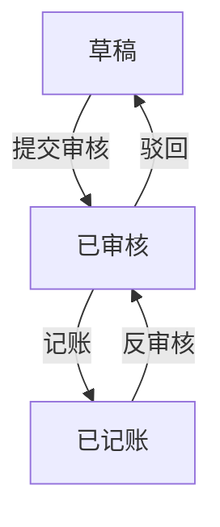

# 凭证管理

## 页面清单

- 凭证列表：按期间、状态筛选，进入详情或新增。
- 凭证录入：维护分录借贷，保存草稿或提交审核。
- 凭证详情：只读已记账分录，支持反审核入口。

## 字段矩阵

| 字段名 | 控件类型 | 必填 | 校验 | 默认值/联动 |
| --- | --- | --- | --- | --- |
| 凭证号 | 输入框 | 是 | 期间内唯一 | 保存后系统生成 |
| 凭证日期 | 日期 | 是 | 必须落在当前会计期间 | 当天 |
| 摘要 | 输入框 | 是 | ≤80 字 | 空 |
| 科目 | 下拉 | 是 | 必须是末级科目 | 空 |
| 借方金额 | 数字 | 否 | ≥0，精度 2 位 | 0 |
| 贷方金额 | 数字 | 否 | ≥0，精度 2 位 | 0 |

## 状态机

## 规则

- BR-voucher-1 同一张凭证借贷合计必须相等才能提交审核。
- BR-voucher-2 已记账凭证不可改分录，只能反审核后修改。

## 验收

- AC-voucher-1 借贷不平衡时点提交，页面提示不平衡金额且状态仍为草稿。
- AC-voucher-2 审核通过后列表状态变为已审核，编辑按钮不可用。
- AC-voucher-3 反审核需会计主管，成功后状态回到已审核且可改分录。
